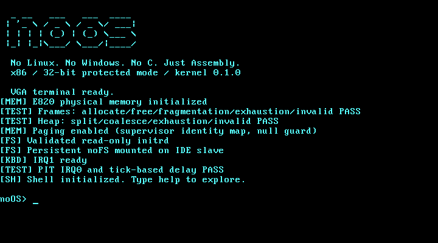
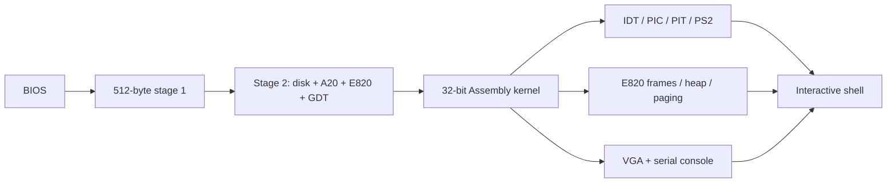

<div align="center">

# noOS
### An operating system written entirely in Assembly

**No Linux. No Windows. No C. Just Assembly.**

[](https://github.com/OthmaneBlial/noOS/actions/workflows/build.yml)
[](kernel/entry.asm)
[](LICENSE)

A tiny BIOS-booted x86 operating system with its own bootloader, protected-mode
kernel, interrupt drivers, memory allocators and interactive shell.

[Project site](https://othmaneblial.github.io/noOS/) · [Field manual](https://othmaneblial.github.io/noOS/docs.html) · [Architecture](docs/architecture.md) · [Test evidence](docs/verification.md) · [Contribute](CONTRIBUTING.md)



</div>

Every instruction that runs inside noOS is NASM Assembly. Python and Make are
host tools for building images and testing emulated hardware. The guest does
not call libc, run on a host kernel, use GRUB or poll BIOS keyboard services
after entering protected mode.

## Boot it

On macOS:

```sh
brew install nasm qemu x86_64-elf-gdb
git clone https://github.com/OthmaneBlial/noOS.git
cd noOS
make
make run
```

On Debian/Ubuntu, install `nasm qemu-system-x86 gdb make python3` instead.
Verified locally with NASM 3.02, QEMU 11.1.1, GNU Make 3.81, Python 3.14 and
cross GDB 18.1. CI tests Ubuntu's packaged NASM/QEMU/GDB independently.

Use the **QEMU window** for PS/2 keyboard input. The host terminal receives COM1
debug output. Type `help` in the guest to explore. Close QEMU to exit; `halt`
halts the guest CPU, while `reboot` restarts the guest.

| Command | Actual behavior |
| --- | --- |
| `help`, `version`, `about` | Command reference and kernel identity |
| `echo [text]`, `clear` | Write arguments or clear the VGA terminal |
| `history` | Eight most recent nonempty commands, including itself |
| `color FB` | Hex foreground/background; `color e1` is yellow on blue |
| `mem` | E820 usable RAM, managed/allocated/free frames and heap usage |
| `uptime` | Actual 64-bit PIT ticks and elapsed seconds |
| `cpu` | CPUID vendor, family, model, stepping and feature bits |
| `sysinfo` | Kernel, paging, CPU, memory, timer and keyboard IRQ statistics |
| `ls`, `cat FILE`, `pwd`, `cd DIR` | Writable noFS root and read-only `/initrd` mount |
| `mkdir NAME`, `touch NAME`, `write FILE [TEXT]`, `rm NAME` | Real IDE disk files; write replaces contents; rm accepts empty directories |
| `reboot`, `halt` | Hardware reset or interrupt-disabled CPU halt |
| `panic [page\|gp\|divide]` | Real CPU fault with vector, error code, EIP and CR2 when applicable |

Arrow keys edit the line; Up/Down browse history while preserving the draft.
Home, End, Delete and Backspace work. Escape clears the draft. Tab inserts a
space. Input is limited to 127 characters, using a basic US keyboard layout.

<!-- progress:start -->
## Roadmap — 92.5%

Progress counts verified gates, including the advanced roadmap. Planned work earns no credit.

| Milestone | Verified |
| --- | --- |
| 1. BIOS boot and protected-mode kernel | 5/5 |
| 2. VGA terminal | 5/5 |
| 3. Interrupt-driven PS/2 keyboard | 5/5 |
| 4. Interactive shell | 5/5 |
| 5. Memory management | 5/5 |
| 6. Hardware and diagnostics | 5/5 |
| 7. Advanced kernel | 2/5 |
| 8. Professional delivery | 5/5 |
<!-- progress:end -->

The percentage comes from [40 explicit gates](docs/progress.json). The same
data powers the website. After verifying a gate, update its boolean and run
`python3 tools/progress.py`; `make test` rejects a stale README or site copy.
[The full roadmap](docs/roadmap.md) includes persistent storage, scheduling,
ring 3/syscalls, validated ELF32 loading and a separate future x86-64 path.

## What is verified

- A signed 512-byte BIOS boot sector preserves the drive and uses INT 13h EDD.
- A second-stage loader reads the real kernel, checks A20, preserves E820,
  installs a flat GDT and transfers to 32-bit protected mode.
- VGA provides colors, wrapping, scrolling, cursor controls, tabs and backspace.
- A 256-entry IDT, remapped PIC, IRQ1 keyboard queue and IRQ0 PIT run in the guest.
- Frame allocation and release use E820, 4 KiB alignment and reserved-region masks.
- A 64 KiB heap supports 16-byte alignment, splitting, coalescing and invalid-free checks.
- Paging maps the first 128 MiB supervisor-only, excludes page zero and pins its
  33 page-table frames. VGA has an uncached mapping.
- QEMU tests cover multiple commands, bad input, history, scrolling, actual CPU
  faults, memory exhaustion, four RAM sizes, hardware reboot and CPU halt.
- GDB reaches the kernel entry using an actual hardware breakpoint.
- A validated read-only initrd embeds actual files; malformed names, sizes,
  offsets, counts and duplicates are rejected before reads.
- A persistent noFS volume uses IDE PIO, redundant checked metadata, alternating
  file data banks and explicit disk flushes. Files survive closing/reopening QEMU.

## Architecture



The kernel is linked as a flat binary at `0x10000`. NASM includes small modules
for drivers, interrupts, memory, shell and library routines. Runtime code lives
only under `boot/` and `kernel/`. [Memory addresses and calling conventions](docs/architecture.md)
are documented explicitly.

## Build, inspect, debug

```sh
make test       # actual headless QEMU + PS/2/QMP tests + GDB
make size       # executable sizes and padded disk size, separately
make debug      # paused QEMU; GDB listens on localhost:1234
make benchmark  # local host-observed boot and command latency
make screenshot # authentic VGA PNG capture (macOS sips conversion)
make clean
```

The image is `build/noos.img`. [CI](https://github.com/OthmaneBlial/noOS/actions)
uploads the validated BIOS image, kernel binary and NASM listing; it also
compares two clean builds byte for byte. There is no public release tag yet.

`make run` also attaches `data/noos-data.img` as the primary IDE slave. This
512 KiB data volume is created only when absent, ignored by Git and preserved
by `make clean`. The boot disk is never written by noFS. Back up the data volume
separately. `cd /initrd` reaches the read-only boot-image files; `cd /` returns
to persistent storage. noFS has 32 entries, 31-character ASCII names, up to
three directory levels and 4 KiB files. The write command is bounded by the
127-character shell line. It has no encryption or secure deletion, and does
not promise durability across arbitrary real-device power failures.

### Measured foundation build

| Artifact | Bytes |
| --- | ---: |
| Stage 1 executable | 512 |
| Stage 2 executable | 641 |
| Kernel executable and static data | 27,704 |
| Raw disk, including sector padding | 32,768 |

At 128 MiB QEMU RAM, E820 reports 130,559 usable KiB. The allocator tracks
32,480 usable frames: 33 pinned for paging and 32,447 free after boot. The heap
arena is in the reserved low-memory region. Run `mem` and `make size` for the
current build; these values are observations, not hardcoded guest statistics.

Three local QEMU TCG boots measured a 434 ms median from process start to
prompt, and 19 ms from emulated Enter to `version` response, including QMP/host
overhead. `make benchmark` writes fresh samples to `build/measurements.json`.
These observations are not physical-machine benchmarks or timing guarantees.

## Scope and technical challenges

Supported initially: QEMU's BIOS `pc` machine, VGA text mode, legacy PIC/PIT,
COM1 and translated set-1 PS/2 input. RAM discovery is 64-bit E820; allocation
and identity mapping currently manage at most 128 MiB. All low 1 MiB is
reserved. BIOS EDD is required; CHS-only machines and UEFI are unsupported.

The difficult boundaries are real BIOS segment/DMA limits, enabling A20 before
flat addressing, interpreting overlapping E820 reservations, safely enabling
interrupts, bounding asynchronous input, preserving exception error frames,
and mapping live stacks and hardware before enabling CR0.PG. Tests exercise
these boundaries instead of treating successful assembly as a boot proof.

Tasks, ring 3, syscalls and ELF executables are still pending.
There is no userspace isolation or physical-hardware compatibility
claim. Contributions should start with a reproducible failure or a scoped
roadmap gate; see [CONTRIBUTING.md](CONTRIBUTING.md).

## License

[MIT](LICENSE) · Copyright 2026 Othmane Blial.
